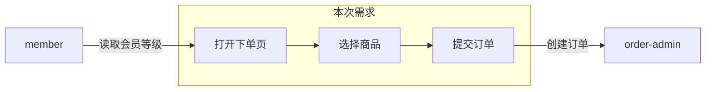

# Workflow:测试需求评审(可测性评审 + 测试点分析)

输入:需求文档 / PRD / 用户的一句话(如"帮我测试用户下单")。
产出:**原子规则清单** + **规则矩阵** + **测试点清单** + **视角覆盖表** + **QA → csspilot Coverage Map** + **系统盘点** + **流程图** + **环境与资料准备清单** + 澄清问题 + 评审结论。测试点清单是 `create-case` 的正式输入;随后按平台写成原生脚本,不再生成 YAML。

## 步骤

1. **复述理解**:用自己的话列出需求覆盖的功能点与业务流程,向用户确认理解偏差。
2. **系统盘点与流程图**:读当前项目 `testpilot.yaml` 的 `web`、`miniapp`、`api` 和 `systems`,把已关联的系统逐条列出,表下紧跟流程图。格式见「系统盘点与流程图」。在评审文件里,这两节排在复述理解之后、规则矩阵和测试点之前,不放到文末。
3. **可测性检查清单**(逐项过):
   - 验收标准是否明确:输入 / 操作步骤 / 预期结果是否可判定
   - 边界与异常:空值、极值、重复提交、并发、权限、网络异常
   - 数据准备可行性:测试账号、mock 数据、上下游依赖是否可用
   - 平台与入口:miniapp / web 的页面路径与入口是否真实存在(不确定时先看项目代码)
   - 回归范围:改动是否影响现有功能,需要哪些已有 Case 回归
4. **拆解原子规则**:从验收标准中提取一条条可独立判定的规则或数据点。粒度必须是“一个输入/条件组合对应一个可判断预期”,不能把多个折扣、角色或状态变化塞进一个测试点。
5. **建立规则矩阵**:
   - 识别需求中的“类型 × 组合”维度,如折扣类型 × 账号等级 × 门槛边界 × 是否叠加
   - 列出每个维度的值域、来源证据和约束
   - 展开全部有效组合,每个有效组合至少生成一个测试点
   - 互斥、不适用或业务禁止的组合不能静默删除,必须记录排除理由及需求证据
   - 项目没有账号、优惠或特定业务系统概念时不得自动添加这些维度
6. **套用 charter 视角矩阵**(固定 5 视角,逐视角过 checklist,为每个 TP 标注视角,可多个):

   | 视角 | tag | 判定问题 |
   | --- | --- | --- |
   | persona | `charter:persona` | 首次用户 / 未登录 / 无权限角色走这个流程会怎样? |
   | 边界输入 | `charter:edge-input` | 空值 / 极值 / 特殊字符 / 超长输入? |
   | 数字与文案 | `charter:numbers-copy` | 金额计算、计数、提示文案是否正确一致? |
   | 状态恢复 | `charter:state-recovery` | reload / 中断 / 返回后状态是否保持? |
   | 错误路径 | `charter:error-path` | 网络失败 / 服务端错误 / 非法操作的表现? |
   | 反向结果 | `charter:inverse` | 成功不该发生时,成功结果是否确实没出现? |

   - 规则:每个测试点至少标注一个视角;某视角在本需求内无任何测试点时,**必须显式记录「不适用 + 需求证据」,禁止静默跳过**。
   - **反向断言**:每条已有明确成功预期的规则,再问一次反面。反面预期必须能从这条规则或对应代码推出来(成功时出现的数据 / 文案 / 状态,在失败、无权限、空数据、前置未完成时不出现、不写入、不变化)。推得出来就新增一条类型为「反向」的测试点;推不出来按下面的三分判定处理,禁止编一个看起来合理的反面文案。
   - **补全清单**(逐项过,有证据才进测试点,没有证据就澄清或暂缓,禁止为了齐全而凑条数):

     | 补全项 | 要问的问题 |
     | --- | --- |
     | 反向结果 | 不该成功时,成功结果是否没出现? |
     | 重复操作 | 连点、重复提交是否只生效一次? |
     | 不可见 / 不可操作 | 无权限或未登录时,入口、按钮、数据是否不可见或不可用? |
     | 空数据 | 列表为空、字段缺失、接口空结果时页面或返回是否符合已有约定? |
     | 前置未完成 | 上一步没做完时,能否进入下一步? |
     | 失败后残留 | 取消、返回、失败之后,是否留下不该留下的订单、缓存或提示? |
   - **三分判定规则**:视角问题想到需求未覆盖的场景(如重复点击、非法输入、文案细节)时,按「需求是否给出预期结果」当场归类,三选一,禁止静默丢弃:

     | 去向 | 条件 | 动作 |
     | --- | --- | --- |
     | 纳入 TP | 需求已有该场景的预期结果 | 进步骤 7 测试点清单,打视角 tag,正常进 `create-case` |
     | 澄清问题 | 需求无预期,且出问题伤业务(资损 / 核心流程 / 数据一致性) | 列入澄清问题(步骤 9),标注视角与风险等级;整单结论至多「有条件可测」 |
     | 暂缓 | 需求无预期,且不伤业务 | 视角覆盖表记「暂缓 + 理由」 |

     澄清问题得到需求方答复后,回流为新 TP 再进 `create-case`。

7. **输出测试点清单**,每条包含:

   | 字段 | 说明 |
   | --- | --- |
   | 编号 | `TP-001` 格式,原生脚本文件头需回链 |
   | 模块 | 所属功能模块 |
   | 场景 | 一句话描述验证什么 |
   | 类型 | 正向 / 边界 / 异常 / 反向 |
   | 优先级 | P0 / P1 / P2 |
   | 平台 | miniapp / web / 双端 |
   | 视角 | 步骤 6 标注的 charter 视角(可多个) |

8. **对标 QA 用例库**(用户提供时):
   - 将每条 QA 用例映射到一个或多个 TP
   - 标记 `covered` / `partial` / `missing` / `conflict`
   - QA 有而 csspilot 无的覆盖形成待补 checklist
   - csspilot 有而 QA 无的覆盖保留并说明来源,不得为追求一致而删除
   - 将完整结果写入 `tests/e2e/reviews/<需求-slug>-coverage.md`,回复中只给摘要和文件路径
9. **澄清阻塞项**:需求缺失、矛盾、不可判定时,列出问题向用户提问。**不猜测**。charter 三分判定产生的澄清问题(带视角与风险等级)一并在此列出。
10. **给出评审结论**:
   - 可测:测试点清单完整,直接进入 `create-case`
   - 有条件可测:部分测试点依赖澄清,先对可执行部分建 Case
   - 不可测:说明缺口,等待需求补充

## 系统盘点与流程图

写入评审产物 `tests/e2e/reviews/<需求-slug>-coverage.md` 的第 2 节:复述理解之后,先系统盘点,流程图紧跟其下,然后再写规则矩阵、测试点和视角覆盖表。

系统盘点列出**当前项目已经关联**的系统,一行一个:

- `testpilot.yaml` 的 `web`、`miniapp`、`api` 段有内容时,各算一个默认系统
- `systems` 里每个名字各算一行
- 本需求会碰到、配置里还没有的系统,加一行并标「未登记」,同时列入澄清问题。没有证据不要补一个系统名

```markdown
## 系统盘点

| 系统 | 类型 | 登记位置 | 本需求中的角色 | 地址或项目路径 | 入口 | 登录角色 |
| --- | --- | --- | --- | --- | --- | --- |
| web | web | testpilot.yaml web | 下单页 | ${WEB_BASE_URL} | /order | test-user |
| order-admin | api | testpilot.yaml systems.order-admin | 核对订单 | ${ORDER_ADMIN_BASE_URL} | GET /orders/{id} | admin |
| member | api | 未登记 | 读取会员等级 | — | — | — |
```

本需求用到的系统,地址或项目路径、入口、登录角色缺任何一项,相关测试点只能标「有条件可测」。登录角色只写引用名,凭据放 `TESTPILOT_ACCOUNT_<REF>`。地址写 `.env.testing` 的变量名,不写内网或生产明文。

流程图标题写成 `## 流程图`,紧挨系统盘点表。用 Mermaid `flowchart`。

- 其它系统只画一个节点,箭头只标交接动作,不展开它内部的页面或接口。
- 本次需求要画详细:在它实际经过的系统上展开入口、关键操作和交出的结果。这些步骤必须来自需求或代码。
- 节点里的系统名必须能在系统盘点里找到。对不上的交接写成澄清问题,不画进图。本需求没用到的已关联系统留在表里,不放进图。

````markdown
## 流程图


````

完成标准:系统盘点和流程图位于评审文件第 2 节;系统盘点覆盖项目里每一个已关联系统;流程图里其它系统只有一个节点,本次需求的步骤已展开,每条箭头都能指回需求或代码。

## 规则矩阵模板

```markdown
| 维度 | 值域 | 来源证据 | 约束 |
| --- | --- | --- | --- |
| discountType | percentage / fixed | PRD §3.2 | fixed 不参与 VIP 加码 |
| accountLevel | normal / vip | account.ts:L10-L16 | 游客不可下单 |

| 组合 ID | discountType | accountLevel | 有效性 | 预期 / 排除理由 | TP |
| --- | --- | --- | --- | --- | --- |
| C-001 | percentage | vip | 有效 | 折扣后再加 VIP 优惠 | TP-001 |
| C-002 | fixed | vip | 排除 | PRD §3.2 明确 fixed 不叠加 | — |
```

矩阵只使用需求、代码、配置、已有 Case 或 QA 用例中的真实维度。缺少证据时提出问题,不得套用电商默认字段。

## QA → csspilot Coverage Map 模板

```markdown
| QA Case | 对应 TP | 覆盖状态 | 差异 / 冲突 | 行动 |
| --- | --- | --- | --- | --- |
| QA-101 | TP-001 | covered | — | 无 |
| QA-102 | TP-004 | partial | 缺少上边界 | 补 dataset 行 |
| QA-103 | — | missing | csspilot 无对应 TP | 新增 TP 和 Case |

## Missing coverage checklist
- [ ] QA-103: 新增……
```

## 视角覆盖表模板

写入评审产物 `tests/e2e/reviews/<需求-slug>-coverage.md` 末尾:

```markdown
## 视角覆盖表

| 视角 | 测试点 | 说明 |
| --- | --- | --- |
| persona | TP-001, TP-003 | 覆盖首次用户与无权限角色 |
| edge-input | TP-002 | 覆盖空值与超长输入 |
| numbers-copy | TP-001 | 金额计算 |
| state-recovery | 暂缓 | 需求无跨刷新状态(PRD §2 未涉及),不伤业务 |
| error-path | TP-004 | 支付失败回退;连点提交无预期且涉资损 → 澄清 Q-2 |
```

## 环境与资料准备清单(固定产出,禁止省略)

对每条测试点自问:**「执行这条 TP 之前,哪些值必须已经存在?」**——测试地址、登录账号、业务造数字段、前置状态,凡命中就必须在清单中登记一行。**禁止"写 Case 时再说"**:评审不定下来,执行层就是确定性缺口。

每项资料按落点**三分类**,这是判定规则,不得凭感觉选:

| 落点 | 放什么 | 判定特征 | 例子 |
| --- | --- | --- | --- |
| `.env.testing` 变量 | 环境位:测试地址、小程序项目路径、Server 地址 | 与"人 / 机器 / 环境"相关,与具体业务数据无关 | `WEB_BASE_URL`、`MINIAPP_PROJECT_PATH` |
| 账号引用名 | 账号角色(只登记角色名与用途;真实凭据走 `TESTPILOT_ACCOUNT_<REF>` 或 Server Secrets) | "以谁的身份执行" | `admin`(后台)、`test-user`(下单用户) |
| `tests/e2e/data/` 业务数据 | 业务造数:测试点依赖的数据及**字段名**、类型、来源 | 与业务数据本身相关(商品、订单、规则入参) | `product.styleNo`(后端造数接口生成,脚本自行读取) |

模板(即使没有任何要准备的资料,**也必须输出本节**并写「无」,附一句依据;三类落点各成一表或合并为一表均可,列必须齐全):

```markdown
## 环境与资料准备清单

| TP | 需要的资料 | 落点 | 变量名 / 字段名 | 来源或生成方式 | 就绪状态 |
| --- | --- | --- | --- | --- | --- |
| TP-001 | 测试环境地址 | .env.testing | WEB_BASE_URL | 用户提供 | 已就绪 |
| TP-002 | vip 账号 | accountRef | vip-user | 用户提供凭据(TESTPILOT_ACCOUNT_VIP_USER) | 待补充 |
| TP-003 | 参与促销的商品 | tests/e2e/data/ | product.styleNo | 后端造数接口 POST /test-support/products | 待补充 |

## Missing data checklist
- [ ] TP-002: 提供 vip-user 凭据
- [ ] TP-003: 确认造数接口可用
```

规则:

- **业务造数一律进 `tests/e2e/data/`**(字段名登记在评审产物,脚本自行读取),**环境位才进 `.env.testing`**,**身份一律账号引用名**——三者不得混放,同一项资料只能有一个落点。混放(如把商品编码塞进 env、把地址写成业务数据)是评审输出不稳定的直接来源。
- 来源不可知的资料(谁提供、怎么造不确定)必须同时进入澄清问题清单。
- 「就绪状态」只有两种:已就绪 / 待补充;待补充项必须出现在 Missing data checklist。
- 本节缺失或含未登记的必要资料时,不得给出评审结论(见铁律)。

## 铁律

- 没有测试点清单,不要进入 `create-case`。
- 没有「环境与资料准备清单」一节,不得给出评审结论;空表也要输出(写「无」+ 依据)。
- 测试点依赖的资料(账号 / 造数字段 / 环境地址 / 前置状态)必须逐项登记落点:`.env.testing`(环境位)/ 账号引用名 `TESTPILOT_ACCOUNT_<REF>`(身份)/ `tests/e2e/data/`(业务造数),禁止混放、禁止执行时再想。
- 没有「系统盘点」和紧跟其下的「流程图」,不得给出评审结论。这两节必须在评审文件第 2 节,紧接复述理解。项目没有已关联系统时,系统盘点写「无」并说明 `testpilot.yaml` 里没有 `web` / `miniapp` / `api` / `systems`。
- 本需求用到的系统缺地址或项目路径、入口、登录角色时,结论只能是「有条件可测」,先澄清再建 Case。
- 评审基于需求 + 项目代码/页面证据;两项都没有时先收集证据,不空谈。
- 每个测试点必须可验证:都能回答"怎么判定通过"。
- 视角覆盖表缺任意一行(含不适用 / 暂缓行)不得给出评审结论。
- charter 三分判定判为「澄清问题」的场景,必须出现在澄清问题清单中(带视角与风险等级),否则不得给出评审结论。
